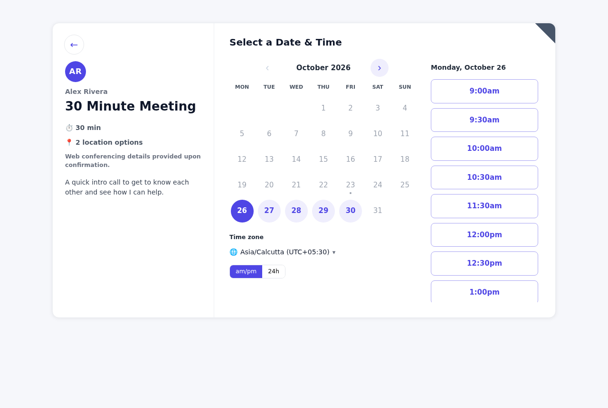

# Cadence — an open scheduling platform (Calendly alternative)

Cadence is a self-hosted, full-featured scheduling app built clean-room after studying Calendly's public
web behaviour with [REA](https://github.com/morluto/rea) (see [`docs/REA-FINDINGS.md`](docs/REA-FINDINGS.md)).
No Calendly code, assets or copy were reused — REA was used to understand *how* the product behaves
(endpoint surface, booking state machine, availability diagnostics codes), and everything here is original.



## Quick start

```bash
npm install
npm run build        # builds the React client into dist/
npm start            # http://localhost:3000  (seeds a demo workspace on first run)
```

**Demo login:** `demo@cadence.app` / `demo1234` (teammates: `priya@cadence.app`, `sam@cadence.app`, same password)

Try the public pages: `/alex`, `/alex/30min`, `/alex/consultation`, `/alex/sales-demo`, `/poll/team-offsite`, `/form/get-started`.

To reset the demo: stop the server, `rm -rf data`, start again.

## Features

### Booking experience (invitee side)
- Profile page listing public event types; secret event types are reachable only by link
- Month calendar → time list → details form, with time zone search/auto-detect and 12h/24h toggle
- Multiple durations per event (invitee picks), spots left for group events
- Custom questions: short/long text, phone, single select, radio, checkboxes; required flags
- Add guests (configurable max), multiple location options (Jitsi auto-generated link, Zoom, Google Meet, Teams, in person, custom, phone — inbound or invitee-provided — or "ask invitee")
- Confirmation page with add-to-calendar (Google, Outlook, .ics), or redirect to an external URL with booking details passed through
- Self-serve **reschedule** and **cancel** links (with reason), both configurable per event type
- **Single-use links** that expire after one booking
- Prices with a simulated checkout (`paid_demo` — wire Stripe into `server/bookings.js` for real payments)
- **Embeds**: inline, popup widget and popup text, via `<script src="/embed.js">`, with `postMessage` events (`cadence.event_scheduled`, page height)

### Event types (host side)
- One-on-one, **group** (max invitees), **round robin** (strategy: optimise availability or equal distribution), **collective** (all hosts free)
- Duration(s), colour, slug, description, active/secret toggles, duplicate, reorder
- Limits: buffers before/after, minimum notice, slot increment, date range (rolling days / fixed range / indefinite), daily/weekly/monthly caps, per-user max meetings per day
- Per-event schedule selection, lock invitee time zone
- **Troubleshoot availability**: per-slot reasons why a time is hidden (PAST, TOOSOON, BUFFER, OVERLAP, CALENDAR, DAYMAX, BLOCK_OUT_DATE, OUTSIDE_HOURS, …), modelled on the diagnostic codes REA surfaced in Calendly's bundle

### Availability
- Multiple named schedules, each with its own time zone and default flag
- Weekly hours with multiple intervals per day, copy to all days
- Date-specific overrides (custom hours or unavailable) and org-wide time off
- **Calendar conflict checking** via any ICS/iCal URL (Google, Outlook, iCloud, Fastmail…), resynced every 10 minutes
- Private **ICS feed** of your bookings to subscribe from any calendar app (rotatable secret URL)

### Meeting management
- Scheduled events: upcoming / past / canceled tabs, search, event-type filter, CSV export
- Per-booking detail: answers, routing answers, guests, source, email log; mark **no-show**, private host notes, copy reschedule link, cancel with reason
- **Contacts** list aggregated from bookings
- **Analytics**: created/active/canceled/rescheduled/no-show totals, events over time, popular event types, meetings by host, weekday and hour heat, booking source

### Automation & integrations
- **Workflows**: email reminders/follow-ups before or after start, on booking or cancel, to invitee or host, with templated variables (`{{invitee_name}}`, `{{event_time}}`, `{{reschedule_url}}` …)
- **Meeting polls**: propose times, invitees vote, book the winning option in one click (optionally holding the proposed times)
- **Routing forms**: questions + rule engine (equals, contains, any of, ≥, ≤, empty…) routing to an event type (with prefill), external URL or message; submission log
- **Webhooks** with HMAC-SHA256 signatures (`Cadence-Webhook-Signature`), test pings and delivery log — events: `invitee.created`, `invitee.canceled`, `invitee.rescheduled`, `invitee.no_show_marked/unmarked`, `routing_form_submission.created`, `poll.vote_created`
- **REST API** with personal access tokens (`Authorization: Bearer cad_…`) — the same API the UI uses
- Emails with .ics attachments via SMTP; without SMTP everything lands in the in-app **Email outbox** for inspection
- **Teams**: organisation members who can host round robin / collective events; per-user branding (brand colour, hide "powered by")

### Reliability details
- Idempotent booking creation (`Booking-Request-ID` header)
- Server-side re-validation of every slot in a SQLite transaction (no double booking, round-robin assignment at commit time)
- Background job runner for workflows (15 s tick) and calendar sync (10 min)

## Configuration

| Variable | Default | Purpose |
|---|---|---|
| `PORT` | `3000` | HTTP port (binds 0.0.0.0) |
| `PUBLIC_URL` | request origin | Absolute base URL used in emails, ICS files and webhooks |
| `DATA_DIR` | `./data` | SQLite database location |
| `NO_SEED` | – | Set to `1` to skip demo seeding on an empty DB |
| `SMTP_HOST`, `SMTP_PORT`, `SMTP_USER`, `SMTP_PASS`, `SMTP_SECURE`, `SMTP_FROM` | – | Real email delivery (otherwise outbox only) |

## Architecture

```
server/            Express 5 + better-sqlite3 + luxon
  index.js         entry: static client, /api, /api/public (CORS *), /feed/:token.ics, /embed.js, job loops
  db.js            schema + helpers          slots.js     availability engine + diagnostics
  bookings.js      create/cancel/reschedule  notify.js    email, ICS, workflows, webhooks, calendar sync
  public.js        invitee API               api.js       host API (session cookie or Bearer token)
  auth.js          sessions/tokens           embed.js     embed widget script
client/src/        React 18 + React Router (Vite)
  public/          booking flow, confirmation, cancel/reschedule, profile, poll, routing form
  app/             dashboard: event types, editor, troubleshoot, scheduled, availability, polls,
                   routing forms, workflows, contacts, analytics, outbox, integrations, team, settings
docs/              REA findings + screenshots
scripts/e2e/       Playwright smoke scripts used during development
```

## How REA was used

1. Fetched a public Calendly booking page and its production bundle.
2. Ran REA's static JavaScript analysis (`analyze-javascript-application`) over the split bundle modules to map the module/import graph and endpoint references.
3. Extracted the booking API surface (41 `/api/booking/*` routes), locale strings for the booking flow states, and the availability-diagnostic code set.
4. Designed Cadence's data model, API and availability engine from those behavioural findings, then implemented everything from scratch.

Full notes: [`docs/REA-FINDINGS.md`](docs/REA-FINDINGS.md).
