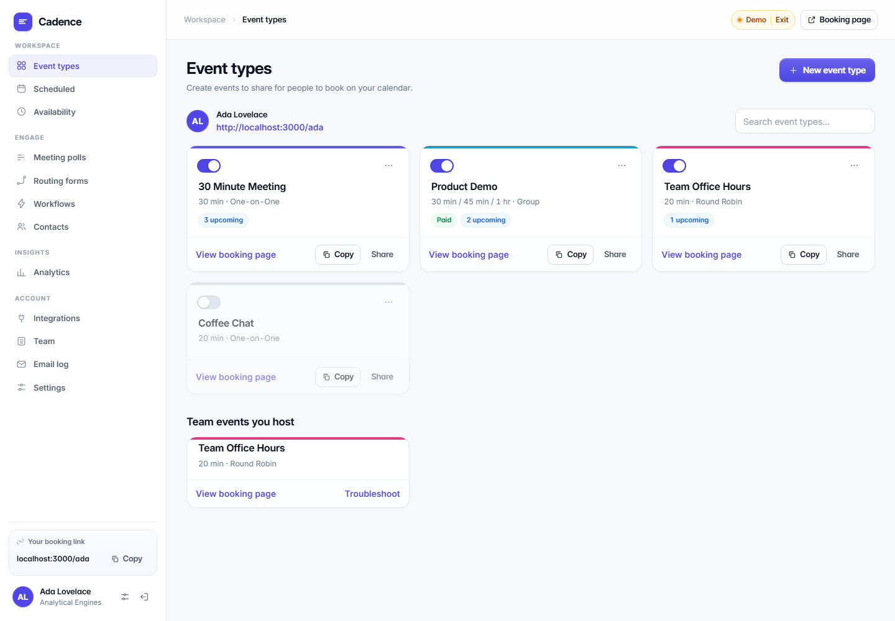
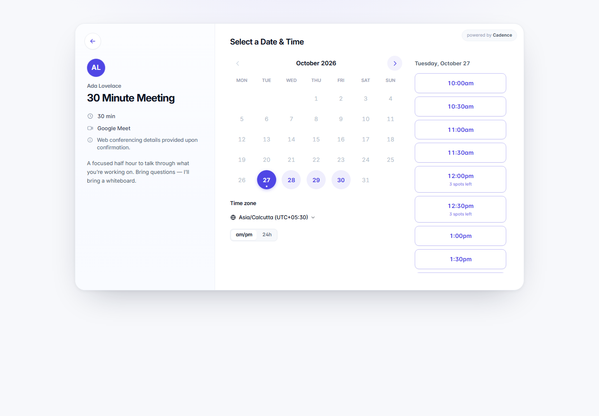

# Cadence — an open scheduling platform (Calendly alternative)

Cadence is a full scheduling app: booking pages, team scheduling, Google Calendar and Outlook sync, Meet/Teams links, paid meetings, workflows, polls, routing forms, webhooks and an API. It runs on **Node.js + Postgres (Neon)** and deploys to **Vercel** as one serverless function plus static assets.

People sign in with **Google** only; there are no passwords and no demo accounts.



## Deploy to Vercel (production)

1. **Create the project.** Import this repo at [vercel.com/new](https://vercel.com/new). `vercel.json` already sets the install and build commands, so you don't need to change any framework settings.
2. **Database.** Open the project, then **Storage → Create → Neon (Postgres)** and connect it to the project. This sets `DATABASE_URL`. The schema is created automatically on the first request.
3. **App secret.** Run `openssl rand -base64 48` and add the output as `APP_SECRET`. It encrypts OAuth tokens and signs cookies, so **never change it** after launch.
4. **Google sign-in and Google Calendar.** In [Google Cloud Console](https://console.cloud.google.com/apis/credentials):
   - **APIs & Services → Library**: enable the **Google Calendar API**.
   - **OAuth consent screen**: app name, support email and your domain. Add the scopes `openid`, `email`, `profile`, `.../auth/calendar.events` and `.../auth/calendar.readonly`. **Publish** the app (calendar scopes need Google verification before the general public can use them; up to 100 test users work right away).
   - **Credentials → Create OAuth client ID → Web application**. The authorised redirect URI is `https://YOUR_DOMAIN/api/auth/google/callback`.
   - Set `GOOGLE_CLIENT_ID` and `GOOGLE_CLIENT_SECRET`.
5. **Outlook / Microsoft 365 (optional).** In the [Azure portal](https://portal.azure.com/), go to **App registrations → New registration**:
   - Supported accounts: *any organizational directory and personal Microsoft accounts*.
   - Redirect URI (Web): `https://YOUR_DOMAIN/api/auth/microsoft/callback`.
   - **Certificates & secrets → New client secret**.
   - **API permissions** (delegated): `offline_access`, `openid`, `email`, `profile`, `User.Read`, `Calendars.ReadWrite`.
   - Set `MICROSOFT_CLIENT_ID` and `MICROSOFT_CLIENT_SECRET`.
6. **Email (optional, works whenever you add it).** Verify your domain at [resend.com](https://resend.com), then set `RESEND_API_KEY` and `EMAIL_FROM="Cadence <bookings@yourdomain.com>"`. Any SMTP server works too (`SMTP_*`).
7. **Payments (optional).** Set `STRIPE_SECRET_KEY`. In Stripe go to **Developers → Webhooks → Add endpoint** with the URL `https://YOUR_DOMAIN/api/stripe/webhook` and the events `checkout.session.completed`, `checkout.session.async_payment_succeeded` and `checkout.session.expired`. Then set `STRIPE_WEBHOOK_SECRET` (`whsec_…`).
8. **Cron.** Set `CRON_SECRET` to any long random string. Vercel calls `/api/cron/tick` with it:
   - The Hobby plan allows one run per day. Due work also runs whenever the app gets traffic.
   - For punctual reminders on Hobby, point an external pinger (for example cron-job.org) at `GET https://YOUR_DOMAIN/api/cron/tick` every 5 minutes with the header `Authorization: Bearer <CRON_SECRET>`.
   - On Pro, set `CRON_SCHEDULE="*/5 * * * *"` instead.
9. **Public URL.** Set `PUBLIC_URL=https://YOUR_DOMAIN` (it defaults to the Vercel production domain). Then **redeploy** so the build picks up the variables.

Visit `/api/health` to see what's still missing. Until the required variables are set, the app shows a setup page instead of failing.

## Environment variables

| Variable | Required | Purpose |
|---|---|---|
| `DATABASE_URL` (or `POSTGRES_URL`) | ✅ | Postgres connection string (Neon) |
| `APP_SECRET` | ✅ | ≥ 32 chars. Encrypts tokens and signs cookies |
| `GOOGLE_CLIENT_ID`, `GOOGLE_CLIENT_SECRET` | ✅ | Google sign-in and Google Calendar |
| `PUBLIC_URL` | recommended | Canonical base URL for links, emails and OAuth redirects |
| `MICROSOFT_CLIENT_ID`, `MICROSOFT_CLIENT_SECRET`, `MICROSOFT_TENANT` | – | Outlook / Microsoft 365 calendars (tenant defaults to `common`) |
| `RESEND_API_KEY` or `SMTP_HOST`/`SMTP_PORT`/`SMTP_SECURE`/`SMTP_USER`/`SMTP_PASS` | – | Outgoing email |
| `EMAIL_FROM` | with email | Sender, e.g. `Cadence <bookings@yourdomain.com>` |
| `STRIPE_SECRET_KEY`, `STRIPE_WEBHOOK_SECRET` | – | Paid event types |
| `CRON_SECRET` | recommended | Protects `/api/cron/tick` |
| `CRON_SCHEDULE` | – | Build-time Vercel cron schedule (default: daily) |

## Local development

```bash
cp .env.example .env    # fill in DATABASE_URL, APP_SECRET, Google keys
npm install
npm run dev             # builds the client, serves on http://localhost:3000
```

On Windows use `Copy-Item .env.example .env` in PowerShell. Add
`http://localhost:3000/api/auth/google/callback` as a second redirect URI on your Google OAuth
client. Any Postgres works locally, for example
`docker run -e POSTGRES_PASSWORD=pw -p 5432:5432 postgres:17`.

### Preview the interface (no database needed)

The client includes a browser-only preview mode. It answers every API call with realistic
sample data, so you can look at the whole interface without Postgres, Google credentials or
an internet connection:

```bash
npm install
npm run dev
```

Open <http://localhost:3000> and click **Preview the interface** (or go straight to
<http://localhost:3000/app?demo=1>). Everything is clickable — create event types, edit
availability, run the booking flow, vote in a poll. The header shows a **Demo** badge; click
it to leave preview mode. Sample data lives only in the browser and resets on reload. The
server still starts normally without configuration and shows the setup checklist under
`/app`, so nothing about the real app changes.

For UI work with hot reload, run `npm run dev:web` (Vite on <http://localhost:5173>) alongside
`npm run dev`, or just use preview mode which needs no backend.

### Tests

These suites run against a local server with the upstream mock preloaded. It fakes Google, Microsoft and Stripe, and enables a dev-only login (`DEV_LOGIN=1`, which is never set in production):

```bash
DEV_LOGIN=1 CRON_SECRET=testcron RATE_LIMIT_PER_MIN=1000 node --import ./scripts/test/mock-upstream.mjs server/index.js &
node scripts/test/api-smoke.mjs        # 42 API checks
node scripts/test/integrations.mjs     # 39 OAuth / calendar / payment checks (set MICROSOFT_* and STRIPE_* test values)
node scripts/e2e/production.mjs        # Playwright: sign-in → onboarding → calendar → booking → paid booking
```

(The e2e script needs `npm i --no-save playwright && npx playwright install chromium`.)

## Features

### Booking experience (invitee side)
- Profile page listing public event types; secret event types are reachable only by link
- Month calendar → time list → details form, with time zone search/auto-detect and 12h/24h toggle
- Multiple durations per event (invitee picks), spots left for group events
- Custom questions: short/long text, phone, single select, radio, checkboxes; required flags
- Add guests (configurable max), multiple location options (Jitsi auto-generated link, Zoom, Google Meet, Teams, in person, custom, phone — inbound or invitee-provided — or "ask invitee")
- Confirmation page with add-to-calendar (Google, Outlook, .ics), or redirect to an external URL with booking details passed through
- Self-serve **reschedule** and **cancel** links (with reason), both configurable per event type
- **Single-use links** that expire after one booking
- **Paid meetings** with Stripe Checkout: the slot is held for 32 minutes while the invitee pays, then confirmed by webhook (or on return)
- **Embeds**: inline, popup widget and popup text, via `<script src="/embed.js">`, with `postMessage` events (`cadence.event_scheduled`, page height)



### Event types (host side)
- One-on-one, **group** (max invitees), **round robin** (strategy: optimise availability or equal distribution), **collective** (all hosts free)
- Duration(s), colour, slug, description, active/secret toggles, duplicate, reorder
- Limits: buffers before/after, minimum notice, slot increment, date range (rolling days / fixed range / indefinite), daily/weekly/monthly caps, per-user max meetings per day
- Per-event schedule selection, lock invitee time zone
- **Troubleshoot availability**: per-slot reasons why a time is hidden (PAST, TOOSOON, BUFFER, OVERLAP, CALENDAR, DAYMAX, BLOCK_OUT_DATE, OUTSIDE_HOURS, …), modelled on the diagnostic codes REA surfaced in Calendly's bundle

### Availability
- Multiple named schedules, each with its own time zone and default flag
- Weekly hours with multiple intervals per day, copy to all days
- Date-specific overrides (custom hours or unavailable) and org-wide time off
- **Google Calendar & Outlook / Microsoft 365** (OAuth): busy times block bookings (per-calendar toggles, refreshed right before each booking), and new bookings are written to the calendar you choose, with an auto-created **Google Meet or Teams** link
- Extra conflict calendars via any ICS/iCal URL (iCloud, Fastmail…)
- Private **ICS feed** of your bookings to subscribe from any calendar app (rotatable secret URL)

### Meeting management
- Scheduled events: upcoming / past / canceled tabs, search, event-type filter, CSV export
- Per-booking detail: answers, routing answers, guests, source, email log; mark **no-show**, private host notes, copy reschedule link, cancel with reason
- **Contacts** list aggregated from bookings
- **Analytics**: created/active/canceled/rescheduled/no-show totals, events over time, popular event types, meetings by host, weekday and hour heat, booking source

### Automation & integrations
- **Workflows**: email reminders/follow-ups before or after start, on booking or cancel, to invitee or host, with templated variables (`{{invitee_name}}`, `{{event_time}}`, `{{reschedule_url}}` …)
- **Meeting polls**: propose times, invitees vote, book the winning option in one click (optionally holding the proposed times)
- **Routing forms**: questions + rule engine (equals, contains, any of, ≥, ≤, empty…) routing to an event type (with prefill), external URL or message; submission log
- **Webhooks** with HMAC-SHA256 signatures (`Cadence-Webhook-Signature`), test pings and delivery log — events: `invitee.created`, `invitee.canceled`, `invitee.rescheduled`, `invitee.no_show_marked/unmarked`, `routing_form_submission.created`, `poll.vote_created`
- **REST API** with personal access tokens (`Authorization: Bearer cad_…`) — the same API the UI uses
- Transactional email (confirmations, cancellations, reminders, invites) with .ics attachments through **Resend** or any **SMTP** server. Until one is configured, Google/Outlook send the calendar invitations and every message is recorded in the **Email log**
- **Teams**: invite by email (owner / admin / member roles); invitees join the workspace the first time they sign in with Google. Per-user branding (brand colour, hide "powered by")
- **Accounts**: Google sign-in only, 30-day sessions you can revoke, account deletion

### Reliability details
- Idempotent booking creation (`Booking-Request-ID` header)
- Every slot is re-validated inside a Postgres transaction with per-host advisory locks (no double booking, even across serverless instances); round-robin assignment happens at commit time
- OAuth tokens encrypted at rest (AES-256-GCM); session tokens stored hashed; CSRF protection via Origin checks; rate-limited public endpoints
- Background work (reminders, webhooks, calendar refresh) runs on a cron endpoint and opportunistically on normal traffic

## Architecture

```
server/              Express 5 + pg + luxon
  app.js             routes, setup gate, cron endpoint, SPA fallback
  index.js           long-running server (timers)    vercel-handler.mjs  Vercel function entry
  config.js          env + feature flags             security.js  AES-GCM, HMAC, rate limits, SSRF guard
  db.js              Postgres schema/migrations      auth.js      sessions + API tokens
  oauth.js           Google/Microsoft OAuth          calendars.js Google/Graph/ICS sync, event writing
  slots.js           availability engine             bookings.js  create/cancel/reschedule (locked tx)
  payments.js        Stripe Checkout + webhook       notify.js    email, ICS, workflows, webhooks
  public.js          invitee API                     api.js       host API (cookie or Bearer token)
client/src/          React 18 + React Router (Vite)
scripts/vercel-build.mjs   Build Output API bundle (static + one function + cron)
scripts/test/        API, integration and upstream-mock test suites
```

## How REA was used

1. Fetched a public Calendly booking page and its production bundle.
2. Ran REA's static JavaScript analysis (`analyze-javascript-application`) over the split bundle modules to map the module/import graph and endpoint references.
3. Extracted the booking API surface (41 `/api/booking/*` routes), locale strings for the booking flow states, and the availability-diagnostic code set.
4. Designed Cadence's data model, API and availability engine from those behavioural findings, then implemented everything from scratch.

Full notes: [`docs/REA-FINDINGS.md`](docs/REA-FINDINGS.md).
